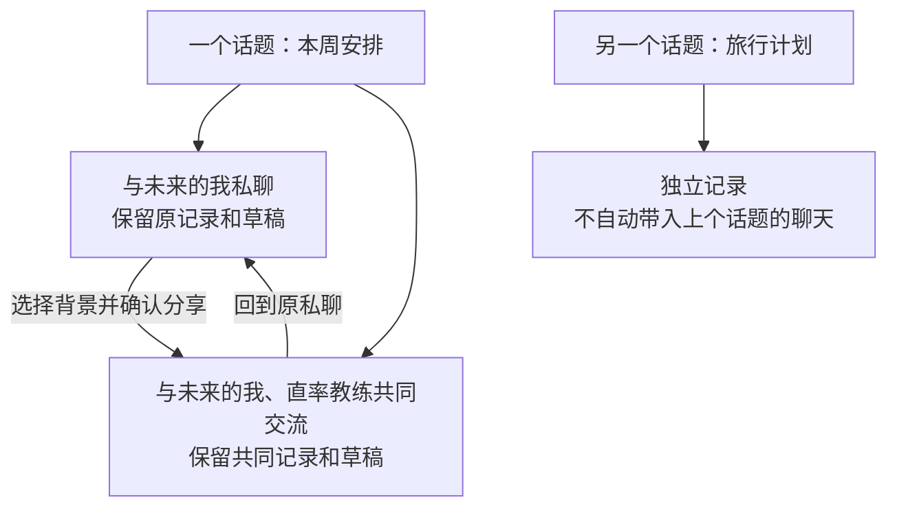

# 导师自然交互与话题连续性

**先看[图解讨论版](visual-prd.html)**：按选导师、加人、切话题与恢复记录的顺序查看页面和状态，再按需查阅本文规则。图示仍是待确认的产品方案，不是已运行 App 的截图；视觉表达不新增需求确认。

**讨论稿 v0.1。当前只讨论产品，不继续开发。** 这版希望做到：看到导师就知道可以和谁聊；想听更多人的看法时直接邀请；聊过的事能找回，切换对象与话题时不会丢失上下文，也不会把私聊自动分享出去。

保留已确认的 [F · 北极星指引](../../../../docs/design/mentor-dialogue.md)与[全局视觉规范](../../../../docs/DESIGN.md)。本稿修改的是人物状态、交流入口和记录组织；下文所有“建议”与 `[ASSUMPTION]` 都待本人讨论确认，不能当作已批准的实现规格。

## 1. 已明确的要求与这次的问题

用户本轮明确提出：人物看起来灰暗；光标到哪个导师，哪个导师就亮起，交流应自然；多导师选择也应自然；需要重新设计交流记录与话题的保留和切换。

当前实现中，舞台人物是不可点击的装饰，未参与发言者统一降低透明度；空圆桌因此让所有导师看起来都像不可用。现有圆桌已有历史入口，但入口较深；单导师与圆桌尚未形成统一的话题体验。解决方向是把人物变成交流入口，而不是单纯提高整页亮度。

使用者仍为本人，主要在 iPhone 上操作，电脑模拟器用于体验与评审。没有光标的手机必须能完整完成相同任务。

## 2. 建议先讨论的整体方案

**以话题保留事情，以导师决定当下和谁交流。** 同一件事可以先找一位导师，再请其他导师一起聊；换人不必重新创建一件事，换一件事也不应覆盖之前的记录。

| 对象 | 对本人意味着什么 |
| --- | --- |
| 话题 | 一件可以持续思考的事，例如“本周怎样安排学习”；有标题、历史与最近进展 |
| 交流段 | 话题中与确定对象的一段交流；可能是与一位导师私聊，也可能是多人共同交流 |
| 消息记录 | 本人原话、各导师回复、时间及真实发送状态，按原先顺序保留 |
| 一次讨论 | 导师对一次发送进行回应的过程；完成或停止后，话题仍可继续 |
| 长期记忆 | 按既有权限跨话题使用的信息，不等于聊天全文，也不会因为换话题而清空 |

`[ASSUMPTION A1]` 建议采用统一话题入口，并在同一话题内保留不同交流段。本人可以读到完整时间线；导师只看到获准给自己的部分。替代方案是私聊与圆桌各保留独立话题，但切换会更割裂。

这张图表达本人如何找回记录；同属一个话题，不代表导师能读取整张图中的内容。

以下是用于讨论的合成场景，不是新增访谈结论：

1. **先和一个人聊。** 本人进入导师页，点“未来的我”，输入“这周应该优先做什么”，发送后开始交流；不用先取标题、选模式或找主持人。
2. **再听一个人的看法。** 想听“直率教练”的意见，点他旁边的加入入口，看到将与谁交流、准备带入什么内容，然后在同一页发送。原私聊仍在原位。
3. **明天接着聊。** 从话题入口找到“本周安排”，恢复上次阅读位置和未发草稿；继续时能看清当前对象。另开“旅行计划”不会清空或混入前一个话题。

## 3. 人物与直接交流

**FR-01 默认可亲近。** 所有可用导师默认都有清楚的脸部、暖色肤色和姓名，不因尚未选中就灰掉。维持沉静深色背景；用人物局部暖光建立层次。真正不可用的导师才显示不可用状态，并写明原因。

**FR-02 光标到达即反馈。** 在支持指针的界面，悬停或键盘焦点到达某位导师时，人物立即轻微亮起并显示清楚的姓名/交流提示；离开后恢复。点选后保留选中标识，正在回复另用说话标记表示，不把三种状态混为一种发光。

`[ASSUMPTION A2]` 建议“经过即亮、点击选定、发送才交流”。悬停不自动发送、不抢走输入焦点、不切换已有草稿或上下文。手机按下时给即时反馈，抬起完成选择，滑过人物继续按滚动处理。若用户想要悬停即切换对象，需要再讨论误切和草稿如何保护。

**FR-03 点导师即可开始。** 点一位导师后，在当前页显示交流对象与可输入的对话区；发送前始终看得清接收对象。当前没有话题时，首次发送先保留话题和待发消息，再尝试发送，标题可之后修改。首次失败或结果未知也能从话题列表找回，不当作空话题删除；恢复时先核对原请求，不能换一个新话题重复发送。只浏览人物不产生空话题，也不触发模型请求。

**FR-04 输入与回看优先。** 键盘出现或回看长记录时，人物区可收成紧凑的成员栏，话题、当前对象与发送操作仍可达。不得为看清人物而挤掉输入区，也不能让整个大人物区域阻断滚动。

## 4. 自然加入多导师

`[ASSUMPTION A3]` 建议在导师身边提供轻量的“＋一起聊”入口，已加入后改为可移除标记；选择留在当前页，不要求先进入独立邀请表单。该动作只准备下一次交流，发送前可以改回。

| 情况 | 建议操作与反馈 |
| --- | --- |
| 尚未选导师 | 点人物，选定一位并展开输入区 |
| 已选一位，想换人 | 点另一位，切到与他的交流段；原草稿留在原段 |
| 已选一位，想加人 | 点其他导师的“＋一起聊”，成员栏即时增加此人 |
| 已选多人 | 继续用加入/移除标记调整；点人物本体只聚焦此人及其资料，不暗中更换消息接收范围 |
| 最后一位被移除 | 回到待选择状态，保留草稿，禁止无对象发送 |
| 正在生成回复 | 可以准备下一次成员选择；界面明确本次仍按原对象进行，不能把进行中的回复改派给新人 |

**FR-05 成员选择可见、可撤回。** 选择一到四位固定导师；所有选择即时显示在输入区上方，键盘弹起后也能确认。仅仅加人、移除或悬停，不调用模型，不产生“某某已发言”的假记录。

**FR-06 发言方式有合理默认。** 两位及以上默认“听听大家的看法”，一次发送后按有限轮次完成。逐一参考、相互讨论等高级选项收在次级入口；不以轮数、预算、模式表单作为开聊前置条件。实际发言者清楚标记，保留补充、停止和查看部分结果。

`[ASSUMPTION A4]` 主持人保留为可选的“帮我梳理”入口；直接点导师时不必先与主持人对话。若多人过程需要主持人参与并读取材料，发送前必须把主持人列为接收对象；不能只显示两位导师却让隐藏的主持人读取全部内容。

## 5. 谁能看到什么

**FR-07 选人同时说清资料范围。** `[ASSUMPTION A5]` 建议“选择哪些人，就与这些人交流”，而非仅决定整桌中谁发言。首次进入新的多人交流段时，在输入区就地显示接收对象和待带入内容；用户可展开修改，发送作为对此次范围的明确确认。同一范围内后续发送不重复弹窗。

加人默认只带入当前准备发送的消息，不自动带上旧私聊全文。若希望对方了解背景，可以选择原消息或审阅一段背景摘要后带入；内容或接收对象发生变化，发送前重新核对。后来的成员默认只收到加入后在该交流段共同发送的内容及显式选择的历史材料。

**FR-08 同一话题不等于共享全部历史。** 换成私聊时保留共同交流记录，但新私聊只给对应导师；同一导师继续自己的获准私聊可恢复原有上下文。移除成员只限制其后续接收，不声称撤回其此前已读内容。导师私有观察和其他话题的聊天不得因标题相同、成员相同或模型摘要而自动共享。

建议按以下规则保持交流连续，仍随 A1/A5 一起讨论：与 A 私聊后加入 B，从下一次发送开始建立 A+B 共同交流段；再回到 A 时恢复本话题原来的 A 私聊。再次选择 A+B 时恢复原共同交流段，但期间的 A 私聊不自动补进去。接收对象不同就使用不同交流段；仅选人而没有输入或发送，不留下空段。

每段草稿独立保留。加减人时不自动挪走已有草稿，可用“带入这段草稿”显式复制到新的对象范围，发送前仍可核对。生成中的对象与下一次准备发送的对象分别标明；新选择只影响下一次发送。相同对象恢复原段，不自动生成多份重复草稿。

这是对现有产品语义的拟议变更：旧圆桌固定让主持人与四位导师可见，所选的两到四位只决定发言人。新方案必须连同权限与历史规则一起确认；不能仅换成勾选头像，就宣传已做到“只有所选导师可见”。

## 6. 记录保留与话题切换

**FR-09 自动保留，可继续。** 各话题保留消息、交流对象、原有可见范围、时间、待发草稿、发送/生成状态及阅读位置。切导师、切话题、离开页面、重启 App 后可恢复。草稿按交流段保存，切换后不会不知情地发给另一个对象；保存失败就地保留内容并提示处理。

**FR-10 轻量话题入口。** 顶部持续显示当前话题，点开即可看到最近话题、搜索与“新话题”。列表展示标题、最近时间、相关导师，以及草稿/未读/进行中状态。恢复话题不自动跳到最后一条；有新回复时提供“查看新回复”，由本人决定是否离开正在阅读的位置。

**FR-11 标题和历史由本人掌握。** 首条消息生成可修改的临时标题，不为取标题强制增加一次模型调用。新话题首次发送前可以取消而不留下空记录。改名不改变历史内容、身份或可见范围；系统不得自行合并同名话题或把旧话题覆盖掉。旧单导师与圆桌记录保留来源，以可识别的历史入口呈现，不自动猜测分类。

**FR-12 切换不会搬走回复。** 话题 A 正在回复时切到 B，A 可在后台按原请求继续，结果始终回到 A，B 只收到未读提示。切换不是停止或重发；结果未知时先核对原请求。新话题不自动引用旧话题全文，但仍可使用原本获准的共享长期记忆。

**FR-13 保留与整理分开。** 默认长期保留直到本人主动处理；可改名、归档并恢复。归档只整理列表，不删除记录；仍在运行的讨论需先处理或明确保留其运行状态，不能静默丢弃结果。删除沿用单独的范围核对，不能以归档代替；已另存的日记与导出副本不宣称随聊天一并删除。

**FR-14 聊天记录不自动成为日记。** 自动保留聊天与“保存到日记”分开；选择 AI 结果写入日记仍需预览确认。AI 建议、本人采纳和实际完成分开，长期记忆仍遵循现有来源与用途规则。跨设备和飞书聊天同步不因本话题设计被默认承诺。

## 7. 北极星与体验验收

北极星继续作为阶段方向入口，与当前话题有区别；换话题不自动改目标。可查看、重选与取消关联，不强制先选北极星才能聊天，也不因为画面展示就自动把目标传给导师。人物亮起时不改变整页底色，不用持续闪烁争夺注意力。

**NFR-01 可操作且可读。** 人物及加入入口具备独立、互不遮挡的触控区域，沿用至少 44 pt 的目标、动态字号和文字对比规范。VoiceOver 可读出导师姓名、选中状态与可用动作，不能只靠变亮或颜色区分。

**NFR-02 反馈连续。** 聚焦与选中不等待网络；遵循既有短动效和 Reduce Motion 规则。离线仍能回看已缓存记录、保留草稿并切换已有话题；未加载的历史清楚标为不可用，不伪装为空。

以下是待验收目标，不是现有成绩：

| 本人操作 | 通过标准 |
| --- | --- |
| 进入导师页直接找一人聊 | 不解释操作也能点中；发送前无需填标题、找主持人或选择高级模式 |
| 从一人增加到两人 | 留在当前页完成，能说清谁会收到什么内容；不会误把加人当作已经发送 |
| 在两个话题间往返 | 原草稿、阅读位置、成员与回复归属不丢失、不串线 |
| 重启后继续昨天的讨论 | 从最近话题找到记录并继续；旧记录没有被重写成新话题 |
| 切到真机和大字号 | 无悬停也能完成全流程，输入、选择、停止始终可达 |

不以发光更强、参与人数更多或聊天更长作为成功标准；出现误发送、错误接收对象或历史丢失即验收失败。自动化通过后仍需本人确认人物明暗、触控与讨论节奏是否自然。

## 8. 边界、旧约定及下一步讨论

这次范围是 iOS 导师交互与话题连续性，不包含重新绘制人物、改品牌配色、改日记编辑、发布生产服务或全渠道聊天同步。当前不提交实现任务，也不修改正在运行的 App。

若确认本稿，将有针对性地更新旧总 PRD 中“无需话题管理”的 FR-19/23，以及旧圆桌的主持人必经、邀请流程和固定整桌可见约定。旧设计的视觉确认继续有效；这份讨论稿尚未取代旧业务基线。

本轮优先确认以下三项，其他细节可以在同一稿继续收敛：

1. **话题组织（A1）：** 是否接受“同一话题里能有私聊与多人交流，本人统一回看、导师按授权分别可见”？
2. **点选手感（A2/A3）：** 是否接受“经过即亮、点击选定、旁边点＋加人、发送才开始”？
3. **多人范围与主持人（A4/A5）：** 是否接受“选中的人才能参与，主持人需要时再加入，旧私聊由本人决定带多少”？

这三项由本人在 PRD 讨论中决定，确认前不进入架构或开发。后续再细化话题入口的位置、标题方式、首次加入时的背景预览，以及跨设备记录的需求；不为了完成文档而替本人确认。
