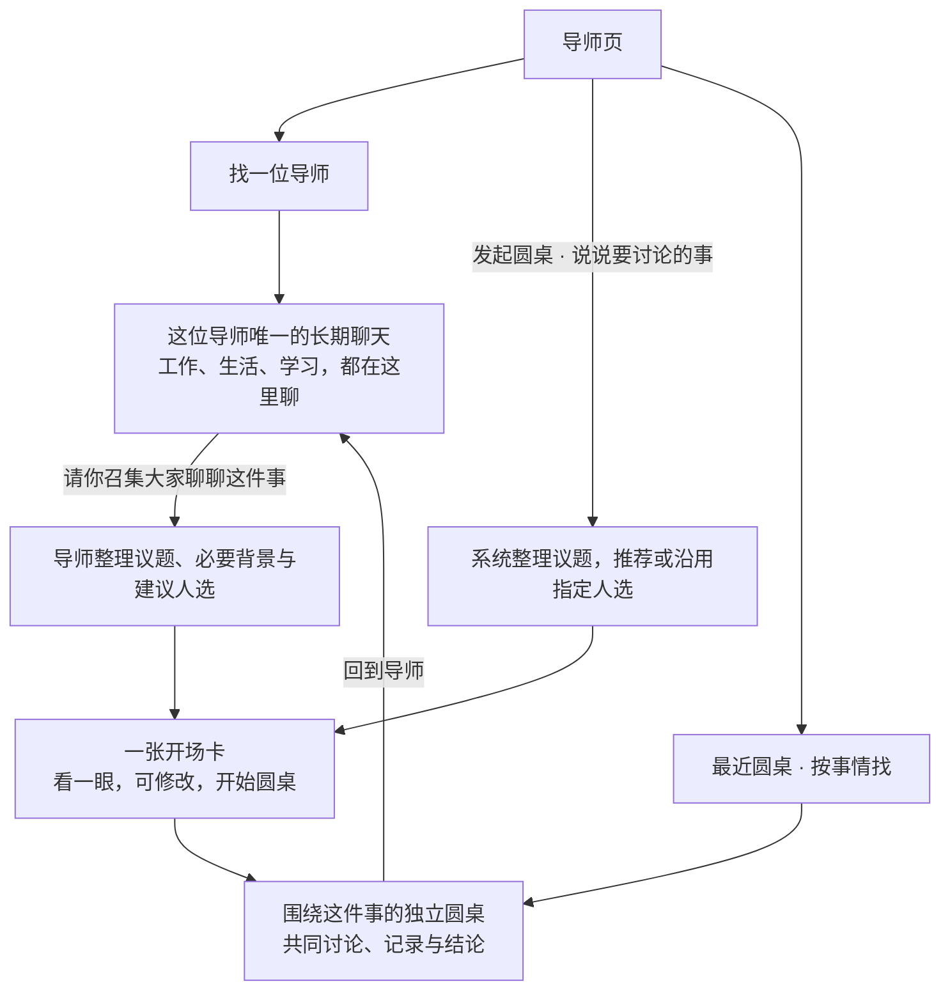

# 导师长期聊天与话题圆桌

**导师按人找，圆桌按事找。** 点“未来的我”，就回到和他的聊天；想让几位导师一起讨论一件事，就为这件事开一场圆桌。

先看[图解讨论版](visual-prd.html)，再按需查阅本文。**v0.2：核心组织方式已由用户确认，操作细节仍待讨论，开发继续暂停。** 图中使用合成内容与低保真占位，不是 App 运行截图或新的视觉确认稿。

继续沿用 [F · 北极星指引](../../../../docs/design/mentor-dialogue.md)与[全局视觉规范](../../../../docs/DESIGN.md)：沉静、空灵、有温度；人物清楚可亲近。灰阶线框仅用于讨论操作。

## 1. 先看整体关系

图中的“开场卡”是 **B1 建议**，尚未确认。导师与圆桌的组织关系、两种发起路径已确认。

| 已确认 | 对应体验 |
| --- | --- |
| **C1 每位导师只有一个聊天入口** | 与同一位导师聊任何话题，都继续在这里；没有“新建私聊话题”或私聊标题管理 |
| **C2 圆桌围绕具体话题** | “本周学习安排”和“是否换工作”各自是一场圆桌，可以分别回来续聊 |
| **C3 两种发起方式** | 可以让正在交流的导师召集、向其他人交代必要背景，也可以自己直接发起 |

私聊保留在各自导师入口，圆桌保留在圆桌记录中。它们可以互相链接，不需要用户理解或管理“交流段”。

## 2. 三个场景，把操作说清楚

### 场景一：今天聊工作，明天聊生活，还是同一个人

**点“未来的我” → 看见原聊天 → 接着说。**

昨天聊“这周应该优先做什么”，今天直接问“周末想休息，又担心落后”。不用先选旧话题或新话题。回来时能看到原记录、未发草稿和新回复；换到王阳明再回来，仍是这一个聊天。

人物默认看得清。电脑上光标到达就亮起，点击进入；手机轻点即可进入。**B2 建议：** 悬停只反馈，不自动换聊天、发送消息或抢输入焦点。输入时人物舞台缩成紧凑栏，让对白、键盘与发送按钮占主位。

### 场景二：请这位导师把大家召集起来

私聊中说：**“帮我叫上直率教练，讨论一下这周怎么安排学习。”** 也可点“请你召集圆桌”。

导师准备下面这样一张卡，无须用户重新讲一遍：

> **这周怎样安排学习**\
> 召集人：未来的我　参与：未来的我、直率教练\
> 给大家的背景：本周可用学习时间有限，希望先确定一项重点，再安排每天的行动。\
> **开始圆桌**　调整

**B1 建议：** 卡片就放在当前对话里。题目、背景、人选都先由导师准备；用户看过后一次开始，也可以直接说“只讲学习，不带其他事情”或就地修改。已经说清的人选和事项不再追问。含糊到无法确定要讨论哪件事时，只问一个必要问题。

开始后进入这件事的圆桌，召集导师先介绍已核对的背景，其他导师随后交流。原私聊留下一个“这周怎样安排学习”的圆桌链接，点它就能回来。取消准备不会留下空会议或更改私聊。

### 场景三：我直接开一场，再回来继续

**导师页“发起圆桌” → 说“想讨论什么” → 看开场卡 → 开始。**

例如输入“想请未来的我和王阳明一起聊聊，要不要换工作”。系统提取题目、人选和已提供的背景；未指定人选时给出可调整的建议，不要求填写标题、背景、模式、轮数等多项表单。直接发起不必先和一个独立主持人聊。

之后从“最近圆桌”找到“要不要换工作”，继续同一场；另一个问题可以再开一场。相同的人参加、甚至标题相同，都不自动合并会议。

以上均为说明交互的合成场景，不是本人真实经历或目标。

## 3. 记录放在哪里

| 想找什么 | 去哪里 | 回来时保留什么 |
| --- | --- | --- |
| 和某位导师的所有私聊 | 点这位导师，必要时在其记录中查找 | 这位导师的消息、草稿、阅读位置与回复状态；换事情不用换入口 |
| 关于某件事的多人讨论 | 最近圆桌，或私聊中的圆桌链接 | 该场议题、参与导师、已分享背景、发言、结论和未发草稿 |
| 圆桌后的个人思考 | 回到想交流的导师 | 继续他的原私聊；可主动引用圆桌中的一段，不把整场自动灌入私聊 |
| 这阶段要走向哪里 | 北极星 | 阶段方向独立保留；换导师、换圆桌不会改目标，也不自动分享目标正文 |

聊天记录完整保存，不等于模型每次读取全部历史。导师对当前事情保持连续理解，但不把另一件事的条件硬套过来；依据不足时自然确认，不能假称记得未读到的内容。

## 4. 系统多做一步，用户少做几步

**自动准备，随时能改。** 从发起语句和这件事的相关对话中提炼议题、必要背景、建议人选。不要求用户从几十条消息里逐条勾选，也不要求先给会议命名。更名是可选整理，不是开聊的门槛。

**只介绍这件事。** 召集导师使用自己已获准的相关内容准备背景；其他导师收到的是开场卡中核对过的内容，不默认拿到整段私聊、其他事项、其他导师的私有观察或日记。新增资料受原有权限约束，摘要不能绕过来源限制。准备时不先把原始私聊发给所有被推荐导师。

**事实与建议分清。** 用户说过的话、计划和 AI 推测分别表述；没有把握的内容不写成既定事实。开场卡默认直接显示完整的短背景，较长材料显示清楚的范围并可展开查看；界面给出的范围必须等于实际传递的范围。

**保持一次轻量核对。** 开场卡不是逐页审批流程。修改背景或人选就在卡上完成，开始后同一范围内的日常消息不重复确认。**B3 建议：** 会议开始后若新增导师，用同样的小卡说明新成员会收到哪些已有背景/讨论，再加入；不把私聊切换做成不断加减人的群聊模式。进行中的这一轮不突然换人，成员调整在下一轮生效。

召集导师是已经选中的参与者，不额外塞入一个隐藏主持人。直接发起时，可由系统建议一位已选导师做开场归纳；不新增第五位隐形接收者。该接收范围相较旧“整桌可见、只选择发言者”的实现是拟议变更，需要未来专门验收。

## 5. 可核对的需求底稿

以下用于保证图解与后续实现一致。**C1–C3 是用户已确认的产品规则；B1–B3 是具体交互建议；FR 是本版候选验收要求，不代表已经实现或全部获批。** FR 编号仅在本专项 PRD 内使用，引用时带版本，不能套用总 PRD 的同号条目。

| 编号 | 要求与验收结果 |
| --- | --- |
| **FR-01 人物清楚** | 可用导师默认有清楚面部、姓名和暖光；未选中不灰成不可用。真实不可用才显示原因 |
| **FR-02 自然聚焦** | 指针/键盘焦点即时反馈；点击或轻点打开导师。聚焦、当前聊天对象和正在发言有不同文字/状态，不仅靠颜色 |
| **FR-03 唯一私聊入口** | 每位导师只有一个长期聊天，任意话题继续其中；无私聊新建、命名或“交流段”选择。历史很长也只在原入口回看、查找 |
| **FR-04 对话优先** | 键盘展开或回看时缩小舞台；输入、发送、返回与停止可达，人物区域不阻断正常滚动 |
| **FR-05 导师召集** | 私聊自然语言或一个召集动作可触发准备；自动提炼当前事项、必要背景和建议人选；明确指定的人选不被悄悄换掉 |
| **FR-06 直接发起** | 导师页独立“发起圆桌”，说出事项即可准备；无强制标题/背景/高级模式表单。人选可指定或接受建议；圆桌含二至四位导师 |
| **FR-07 轻量开场卡** | 同一张卡呈现议题、全部接收者和实际背景，可修改/取消后一次开始；未满二人、含不可用成员或无法准备时，保留输入并就地说明，不能假开场 |
| **FR-08 主题圆桌** | 每场围绕具体事项保存独立记录；采用有限讨论的合理默认，标记发言人，支持补充和停止。高级模式不作为开始前提；新增成员按 B3 处理 |
| **FR-09 私聊与会议互达** | 召集成功后原私聊保留该场链接；圆桌可返回原导师聊天。取消或未成功创建不显示“已开场”，重复点击不创建重复场次；链接不扩大内容可见范围 |
| **FR-10 按事找圆桌** | 最近圆桌按事项展示题目、参与者、最近进展、草稿/未读/进行中状态，可查找、续聊和发起另一场；私聊不放进话题列表。同标题或成员不自动合并 |
| **FR-11 自动保留** | 私聊按导师、圆桌按场次分别保留记录/草稿/阅读位置/状态；切换、离页及重启不串线。未确认开场卡也留在发起处可继续编辑，不作为已开场圆桌；取消后回原入口 |
| **FR-12 中断可恢复** | 切换不停止或重发，迟到回复回原聊天/会议；失败、未知、已停止与部分结果区分，先核对原请求再恢复。离线可读缓存、写草稿，发送失败内容保留；保存失败显式提示且不清空现场 |
| **FR-13 范围真实** | 实际接收者与开场卡一致，私聊背景限已核对事项；历史、来源性质、权限和版本可追溯。不让摘要或标题相同导致扩大共享；不默认新增日记、私人观察或北极星资料权限 |
| **FR-14 整理与日记** | 圆桌可改名、归档和恢复，归档不删除；单导师入口常驻。删除需另核对范围；选定 AI 结果存日记仍先预览确认，聊天保留不等于日记写入、长期记忆或跨设备同步 |

**NFR-01：** 沿用至少 44 pt 触控目标、动态字号、对比度与 VoiceOver；手机无需悬停，全流程可完成。开场卡、成员选择与圆桌返回都支持辅助操作。

**NFR-02：** 聚焦/点选不等待网络；沿用短动效和 Reduce Motion；未加载的历史与没有记录分开显示。网络和生成状态不遮住输入，不能用永久转圈掩盖失败。

持久保存、去重和请求核对由系统负责，不作为“先保留待发消息”“临时标题”等说明放进正常产品流程。自然的界面文案是“接着聊”“请你召集圆桌”“开始圆桌”“消息还没发出，重试”。

## 6. 用这几件事验收体验

| 试一试 | 应该发生 |
| --- | --- |
| 今天与未来的我聊学习，明天聊生活 | 点同一个人就能聊，无话题选择；昨天的记录仍在 |
| 请他召集直率教练讨论学习 | 自动出现简短、准确的题目/背景/人选；看一次即可开场，无需重讲或填表 |
| 把背景改成“只讨论学习时间” | 其他成员只能收到修改后的范围，没有被取消的私聊材料 |
| 直接发起一场“要不要换工作” | 从导师页完成，走同一种开场卡；不必先找主持人 |
| 回到私聊，再从链接回圆桌 | 两处的草稿、记录、阅读位置各自恢复，不产生第二份私聊 |
| 同样两人，明天讨论另一件事 | 新场次独立；想续旧事时也能找回原场次，不自动合并 |
| 导师还在回复时切走或断网 | 回原处能找到真实状态；没有串线、重复开场或假完成 |
| 用手机和大字号重做上述流程 | 触控可用，输入区可见，无指针也无功能缺失 |

以上是待验证目标，不是测试成绩。图解的本地演示只能检查流程表达，人物明暗、真实触控与讨论节奏仍需后续 App/真机验收。

## 7. 本轮保留的讨论点

- **B1 开场方式：** 默认由导师准备一张卡，用户看过后一次开始；这是对“自动召集”的具体实现建议，还可以讨论是否进一步省去这一步。
- **B2 点选手感：** 经过即亮、点击进入；手机轻点进入。不会因光标路过就切走已有聊天。
- **B3 圆桌中途加人：** 下一轮加入，先就地看新成员与必要背景；需要细化退场和后续可见范围。已收到内容不能声称被撤回。

异常保存的具体恢复控件、运行中归档和删除范围留到相应细节讨论；不得据此实现静默丢记录或删除。已有老记录先保留原来源，历史回填不靠 AI 猜测合并。

## 8. 与上一版和现有产品的关系

v0.2 取代 v0.1 的“统一话题 → 私聊/多人交流段”建议，撤销原 A1 和私聊就地加人为共同段的 A3；保留人物聚焦、草稿恢复和资料范围的诉求。旧稿与旧评审放在 [history/v0.1](history/v0.1/prd.md)，旧评审不能作为本版审阅结果。

本轮 C1 与总 PRD 的持续私聊方向一致；C2/C3 更新旧圆桌“一个持续主持人入口、无话题列表”的方向。总 PRD FR-23/25、Issue #56 和相关架构暂作现有运行基线；后续授权实施时应同步调整，不能只换界面就宣称权限语义已改变。

本轮交付只含需求文档、图解和 PRD 技能更新；不改 App、不更新 Air、不承诺飞书或跨设备聊天同步。已确认视觉继续有效，后续继续围绕本稿讨论。
