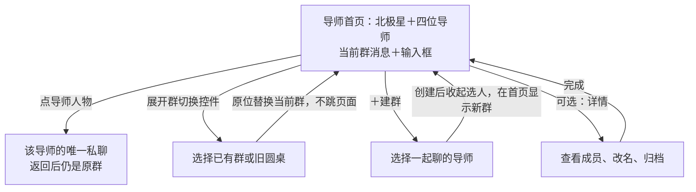

# 导师私聊与群聊

**找一位导师，点上方人物进入私聊；和几位一起聊，就在导师首页下方聊。** 北极星、导师人物、当前群消息和输入框在同一页，切群不跳页面。

先看[图解讨论版 v0.3.3](visual-prd.html)。**2026-10-17 用户明确确认：“是，在导师首页直接聊天，不跳页面”。这次确认覆盖 v0.3.2 的“首页点群 → 群聊天页”解释；当前实现已通过本轮本机回归，详见[验证记录](../../../../docs/testing/ios-mentor-inline-chat-2026-10-17.md)，待用户体验确认。** 单导师仍从人物进入固定私聊，群详情仍是可选辅助操作。图解中的聊天为合成示例；人物沿用现有本地素材，正式视觉继续沿用 [F · 北极星指引](../../../../docs/design/mentor-dialogue.md)和[全局规范](../../../../docs/DESIGN.md)。这里借鉴的是熟悉的持续聊天方式，不表示接入微信或复制其全部功能。

## 1. 首页长什么样

```text
┌─────────────────────────────────┐
│ 导师                      ＋建群 │
│              ✦ 北极星           │
│  温柔回顾者 直率教练 未来的我 王阳明 │
│       点人物进入固定私聊          │
├─────────────────────────────────┤
│ 当前群：本周学习安排 ▾       详情 │
│ 我：这周想集中做一件事。          │
│ 直率教练：先定一个小结果。        │
│ 未来的我：看看它与阶段方向的关系。│
│                                 │
│ [直接在这里输入…]          发送 │
├─────────────────────────────────┤
│ 日记      导师      记忆     设置 │
└─────────────────────────────────┘
```

**私聊入口只放在上方人物区。** 点“未来的我”进入他的固定聊天；下方不重复列出导师。人物清楚、有暖光，支持指针时经过即亮，手机直接轻点。北极星继续表示阶段方向。

**P1 群切换实现默认：** 首页下方就是聊天区：群切换控件、当前群名与成员、消息和输入框。同时只挂载一个群；选择另一群就地替换消息与输入，不执行页面跳转，也不显示群级返回按钮。切换控件可显示最近消息、草稿或未读提示，已归档群仍可找回。新群、已有群和旧圆桌都在这一区域显示；没有群时提供建群/恢复入口，不自动造群。已有选择且仍可访问时恢复原群，否则从可用群选择或展示明确空态。

键盘弹出、横向空间不足或使用无障碍大字号时，上方场景收紧，让消息和输入可读可操作。群切换仍可使用，避免两个嵌套的纵向滚动区争抢手势。

## 2. 就两种聊天



| 用户本轮已明确 | 对应规则 |
| --- | --- |
| **C1 每个导师有独立对话框** | 同一导师始终只有一个私聊，聊什么都不用另建话题 |
| **C2 多人讨论通过建群进行** | 建好后就在群里交流，不必每次重新发起会议 |
| **C3 群既可专注一个话题，也可长期固定使用** | 两者使用相同的群聊能力；不设置“专题 / 长期”必选类型，不强制换话题就换群 |
| **C4 上方人物进入私聊，下方直接群聊** | 保留首页人物场景；当前群的消息和输入在首页显示，换群原位完成，单导师仍进入独立私聊 |

“本周学习安排”和“长期同行群”只是群名示例。群名帮助辨认，不是系统给内容划定的硬边界；用户可以换话题、改群名，原记录仍在。

## 3. 三段实际使用过程

### 和一位导师聊

点上方“未来的我”，打开历史和输入框，直接说话。昨天聊学习，今天聊生活，都在这里；返回首页、换导师再回来，草稿和记录各自保留。

### 想听几位导师一起聊

**点“＋建群” → 勾选导师 → 点“创建” → 回到导师首页，在下方新群发第一条消息。**

**P2 建群实现默认：** 选择二至四位导师，本人默认在群里，不额外选择主持人。群名先用成员名字组合，之后可在群详情改成“本周学习安排”。不必先填题目、背景、模式或开场介绍。

明确点击创建就建立一个可找回的群，即使暂时没发消息也保留。创建前返回则不建群；创建失败保留已选人选，不显示假成功。相同导师可以组成多个不同群，系统不把它们自动合并。

想讨论什么，直接写在群里。如果需要带入一段私聊，之后可以选择那段内容转发到群中；这是可选动作，不是建群前置步骤。

### 明天还想聊

进入导师首页即可接着当前群聊；需要时在群切换控件选“本周学习安排”，原位显示它的记录和草稿。也可以另建“长期同行群”，之后每天都在里面讨论不同事情。群是持续存在的聊天空间，一轮回复结束、离开页面或隔天回来，都不结束这个群。

以上为合成示例，不是用户真实经历或目标。

## 4. 群里怎么交流

输入与回看使用熟悉的聊天方式：显示说话人的姓名、头像和消息。**群消息与输入框就在导师首页的人物场景下方**；群名、成员、切换控件和可选详情帮助辨认当前群，不再导航到群聊天页。一次仅显示一个活跃群，切换不改变原群的草稿、阅读位置、请求或保存来源；迟到回复留在原群。北极星的含义和资料使用边界不变；不用在每条消息前选择讨论模式。

**P3 回复节奏实现默认：** 普通消息默认让群内导师各给一轮简短回应，每位至多一条，不自动无限往复。想只听一位时，可以 `@导师`，由被点名者回应；其他人仍是群成员，`@` 不把群消息变成私信。发送前可看见“大家回应”或“仅某某回应”的简短提示；该默认节奏在本轮获准实施，实际交流感受仍需体验验收。

群成员就是该群信息的接收范围，不额外加入一个隐形主持人。私聊全文和其他群记录不会因为建群或成员相同而自动带入；既有已授权共享记忆仍按原有规则使用，不能把它说成已经读取全部历史。日记、北极星材料和导师私有观察的权限不因建群而扩大。

群创建、消息发送、引用私聊是不同动作。**建一个没有私聊材料的新群，不需要开场卡或背景确认。** 主动转发私聊时，只核对这次选中的内容和目标群；正常续聊不反复核对同一范围。

## 5. 记录和群详情

| 内容 | 保存和找回方式 |
| --- | --- |
| 导师私聊 | 按导师固定保存；从上方对应人物进入原私聊 |
| 群聊 | 首页直接显示当前群，使用群切换控件原位换群；按具体群保存，改名不变记录，相同成员或群名不合并 |
| 旧圆桌记录 | 保留原记录身份、主持人、成员与实际接收范围；从群切换控件选中后在首页显示原消息，不自动转换为新群 |
| 草稿和回复状态 | 留在原私聊或原群；切换不会把草稿发到另一处，迟到回复也回原处 |
| 群详情 | 次级入口显示成员、改群名；不把群管理表单放到每次聊天前 |
| 不常用的群 | 可收起到归档并恢复；收起不删除记录，上方导师人物入口仍保留 |

**加人、移除和旧记录范围是待细化的群管理行为。** 当前建议新加入者从加入后的消息开始参与；如需补充旧背景，再明确转发必要片段。移除成员不能声称收回其已经收到的内容；进行中的回复先按原范围完成或停止，不能突然改派。首版是否提供中途成员调整，留在后续讨论，不为此给建群增加流程。

## 6. 需求与验收底稿

C1–C4 与 P1–P3 已由用户本轮批准开发；下列 FR/NFR 作为首版验收要求。**成员中途变更 FR-12 只落实“不扩大历史范围”的边界，本轮不提供加减人；删除和私聊转发的独立交互另行细化，不增加占位入口。批准不代表已经实现或验收。**编号在本专项 PRD 的 v0.3 系列内保持稳定。

| 编号 | 要求 / 验收结果 |
| --- | --- |
| **FR-01 人物场景** | 导师首页上部保留四位导师与北极星空间画面，可用导师清楚可亲近，未选中不灰成不可用；正式视觉沿用 F |
| **FR-02 入口不重复** | 私聊只从上方导师人物进入；下方直接显示当前群消息与输入，选择群原位替换，不 push 群聊天页；不存在“记录总入口 → 群列表 → 消息”的路径。删除“我的导师”及四条重复私聊入口，手机可完整滚动与点击 |
| **FR-03 固定私聊** | 每位导师唯一聊天；任意话题直接说，没有私聊新建话题或命名操作；记录、草稿、未读各自保留 |
| **FR-04 简单建群** | 选二至四位导师后创建，在导师首页原位显示新群；本人默认在场，无主持人/类型/标题/背景/模式必填。创建前取消不留下群；不足二人或成员不可用时不能假创建 |
| **FR-05 群持续存在** | 创建成功即在群切换控件可找回，即使尚无消息；一轮回复结束不关闭群。专题和长期使用共用一种群，用户可换话题 |
| **FR-06 直接群聊** | 导师首页直接显示一个当前群的消息、输入及紧凑群信息。新群、已有群和旧圆桌原位切换，不跳聊天页，也没有群级返回按钮；无会前卡或重新开会步骤 |
| **FR-07 回复节奏** | 按 P3 提案展示普通消息与 @ 的回应范围；不自动无限讨论，可停止并保留已交付的部分；点名不改变群内可见范围 |
| **FR-08 信息范围** | 只有实际群成员接收群消息，其他私聊/群不自动导入；转发仅发送核对过的选定材料。共享记忆仍按既有权限，不出现隐藏主持人 |
| **FR-09 连续记录** | 私聊按导师、群聊按群分别恢复记录/草稿/阅读位置；切换、离页、重启不串线。迟到结果留在原群，有新回复时可在首页主动切到该群查看；切群不挪用待发消息、选中回复或保存预览 |
| **FR-10 找回和整理群** | 首页群切换控件可找群、恢复收起的群；同成员、同名群分别保留，不自动合并。归档不删除，仍在运行的讨论不静默丢结果 |
| **FR-11 群名与详情** | 建群给出默认成员组合名，后续可改名；改名不重建群或改变历史。群详情可查看真实成员，不承担日常发消息的前置步骤 |
| **FR-12 成员变化** | 中途加减人入口和旧记录策略继续讨论；不得默认为新成员读全部历史，也不能假称移除可以撤回已读内容；运行中回复归原范围 |
| **FR-13 异常恢复** | 建群、发送失败保留输入/选择；结果未知先核对原操作，重试不重复建群或发消息。离线可读缓存、写草稿；未加载历史不显示为空，保存失败不清空现场 |
| **FR-14 日记与删除** | 保留聊天不等于写入日记或自动采纳 AI 建议；选定 AI 结果保存日记仍预览确认。删除另核对范围，不承诺同步删除导出副本或新增跨设备聊天同步 |

**NFR-01 可读可操作：** 至少 44 pt 触控目标、动态字号、清晰对比度和 VoiceOver。支持指针时悬停即反馈；没有光标也可轻点完成。触摸滚动经过人物不会误开聊天。键盘和大字号时收紧人物区，保留可达的群切换与输入，避免嵌套纵向滚动冲突。

**NFR-02 反馈连续：** 人物反馈和本地选择不依赖网络；动效遵循 Reduce Motion。等待或失败状态就地呈现，不遮住输入，不用无限转圈冒充正在处理。

## 7. 这版先试这几件事

| 操作 | 期待的结果 |
| --- | --- |
| 点上方未来的我，写草稿；返回首页后再点他 | 恢复原私聊和草稿；首页仍显示原群，没有重复导师入口 |
| 首页选择“本周学习安排”，再切“长期同行群” | 群消息与输入在首页原位替换；没有跳页或群级返回按钮，两份草稿各自保留 |
| 首页切换到一条旧圆桌记录 | 在相同聊天区显示原消息；保留原主持人、成员/接收范围，不自动变成新群 |
| 建一个群，但先不发消息 | 首页立即显示该空群，切换后仍能找回；没有要求先填议题或介绍 |
| 同样两位导师分别建“学习安排”和“长期同行群” | 是两个独立群，各自有历史与草稿 |
| 在长期群从学习聊到生活 | 直接继续说，不创建新会议，不要求切换话题模式 |
| 私聊后进入群 | 没有自动出现未主动分享的私聊材料 |
| 群正在回复时切到另一群或私聊 | 迟到回复仍留在原群，不覆盖当前群的输入；各自草稿保留 |
| 弹出键盘或使用大字号 | 人物场景收紧，当前群、消息、输入和切换控件仍可操作 |
| 离线或创建结果未知后返回 | 能找到输入与真实状态，不重复建群，不把缓存缺失当作历史已删除 |

以上流程已有本机回归覆盖，详见[验证记录](../../../../docs/testing/ios-mentor-inline-chat-2026-10-17.md)。图解演示用于核对流程；人物明暗、输入手感、AI 节奏仍待用户体验确认，真实服务与真机可用性另行验收。

## 8. 版本变化与讨论边界

v0.3.3 记录 2026-10-17 的明确确认：“是，在导师首页直接聊天，不跳页面”。原先将需求理解为“首页群列表 → 群聊天页”仍多了一次跳转，现改为首页内联消息、输入及群切换。单导师仍从人物进入私聊，群记录/请求/草稿/资料权限不变；键盘优先让出场景空间。当前已实现并通过本轮本机回归，待用户体验确认。原 v0.3.2 文字和图解完整保存在 [history/v0.3.2](history/v0.3.2/prd.md)，以下为历史沿革，不作为当前导航规则。

v0.3.2 记录 2026-10-16 用户的模拟器反馈：“下面已有的合成圆桌记录，点进去……很重复，没有必要再多一层了，直接在第一层……显示群聊，就类似于微信”。据此明确：首页每群一行，点入就是消息；首页保留大人物与北极星，群页采用紧凑成员/方向信息；旧记录仍可访问。原 v0.3.1 文本与图解保存在 [history/v0.3.1](history/v0.3.1/prd.md)，2026-10-15 的测试记录仅证明当时版本，不预先证明本次修正已通过。

v0.3.1 根据用户最新要求移除下方“我的导师”及四条私聊入口：上方人物负责私聊，下方列表只负责群聊。原 v0.3 保存在 [history/v0.3](history/v0.3/prd.md)。

v0.3 将主流程收敛为“联系人私聊 + 持续群聊”。v0.2 的导师召集、会前摘要、开场卡、按新事项重新开会均不再作为主流程。用户现在明确允许长期固定群，不能继续以“每个事项必须独立开圆桌”限制使用。v0.2 存于 [history/v0.2](history/v0.2/prd.md)，旧评审和旧测试不代表本版结果。

用户于 2026-10-15 明确“同意，按这个 PRD，开发”，因此采用本稿 P1–P3 默认。中途加减成员及完整删除交互不在首版开发范围；归档时要求先停止或完成当前回复，恢复后在同一群继续。

总 PRD、Issue #56 和架构仍记录现有运行基线；后续授权实施时同步调整群身份、历史、实际接收范围等约定。本轮按此批准开展 App 和本地服务代码实现，保留已确认视觉。生产 Air 更新、真实数据迁移和真机安装另行按对应边界执行。图解含本地个性化角色素材，仅供本地评审，不纳入本轮公开发布。
